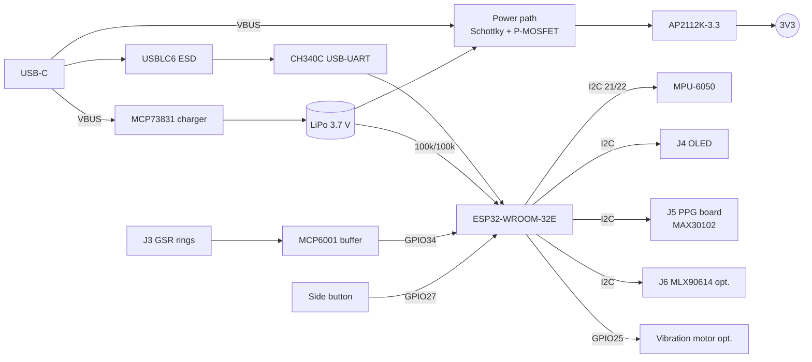

# NeuroBand AI – PCB Design Specification (v1)

Hardware spec for turning the breadboard prototype (ESP32 DevKit + MAX30102 + MPU6050 + GSR + jumper wires) into a wrist-worn device. It matches the pins already used in [`neuroband_esp32/src/main.cpp`](neuroband_esp32/src/main.cpp), so the existing firmware runs with only small additions (OLED, button, motor).

> Not a medical device. The GSR electrodes touch skin; keep the current tiny (this design limits it to < 33 µA).

---

## 1. System overview

Two boards, one case:

| Board | Size | Layers | Where |
|---|---|---|---|
| **Main board** | 32 × 36 mm, rounded corners, 4× M2 holes | 4 layers, 1.0 mm thick | Under the OLED, above the battery |
| **PPG sensor board** | 12 × 15 mm | 2 layers, 0.8 mm thick | In the bottom shell, behind the skin window |



### I²C address map (no conflicts)

| Device | Address |
|---|---|
| SSD1306 OLED | 0x3C |
| MAX30102 | 0x57 |
| MLX90614 (optional) | 0x5A |
| MPU-6050 (AD0 = GND) | 0x68 |

---

## 2. ESP32 pin map

| ESP32 pin | Net | Notes |
|---|---|---|
| GPIO21 | I2C_SDA | 4.7 k pull-up to 3V3 (same as firmware) |
| GPIO22 | I2C_SCL | 4.7 k pull-up to 3V3 |
| GPIO34 | GSR_ADC | ADC1, input-only (same as firmware `GSR_PIN`) |
| GPIO35 | BATT_ADC | ADC1, input-only (same as firmware `BATT_PIN`) |
| GPIO27 | BTN | Side button to GND, use `INPUT_PULLUP` (new) |
| GPIO25 | MOTOR | Gate of motor MOSFET (new, optional) |
| GPIO0 | BOOT | BOOT button to GND + 10 k pull-up + auto-reset |
| EN | RESET | 10 k pull-up + 1 µF to GND + RESET button + auto-reset |
| GPIO1 (TXD0) | → CH340C RXD | |
| GPIO3 (RXD0) | ← CH340C TXD | |

**Do not use:** GPIO6–11 (internal flash), GPIO12 (must be low at boot or the flash voltage is wrong), GPIO2/5/15 (boot strapping pins). ADC2 pins don't work while Wi-Fi is on, which is why the analog inputs stay on ADC1 (GPIO34/35).

---

## 3. Main board schematic, block by block

Part numbers are **manufacturer part numbers (MPN)**. Type them into the LCSC / EasyEDA part search to get the LCSC code and footprint.

### 3.1 USB-C and programming

- **J1** USB-C 16-pin receptacle, `TYPE-C-31-M-12`.
  - A6 + B6 → `USB_DP`, A7 + B7 → `USB_DM` (tie the pairs together).
  - **CC1 → 5.1 k → GND, CC2 → 5.1 k → GND** (R5, R6). Without these, USB-C chargers give 0 V.
  - VBUS pins → `VBUS`; GND + shell → GND.
- **U3** `USBLC6-2SC6` ESD: I/O1 = D+, I/O2 = D−, VBUS pin = VBUS, GND. Place it right behind J1.
- **U2** `CH340C` (internal oscillator, no crystal needed):
  - VCC and V3 both to 3V3, 100 nF to GND.
  - UD+ → `USB_DP`, UD− → `USB_DM`.
  - TXD → ESP32 GPIO3, RXD ← ESP32 GPIO1.
- **Auto-reset** (so you don't press buttons to flash), Q1/Q2 = `MMBT3904`, R3/R4 = 10 k:
  - Q1: base ← 10 k ← DTR, emitter ← RTS, collector → EN.
  - Q2: base ← 10 k ← RTS, emitter ← DTR, collector → GPIO0.

> Power note: CH340C runs from 3V3, so it also draws a little from the battery when USB is unplugged. If standby current is a problem later, the v2 fix is an ESP32-S3/C3 module with native USB (drops CH340C, Q1, Q2).

### 3.2 Charging and power

| Ref | Part | Connection |
|---|---|---|
| J2 | JST-PH 2-pin SMD `S2B-PH-SM4-TB` | Battery. **Check your LiPo's red wire matches pin 1 = BAT+; cheap batteries come both ways.** |
| U4 | `MCP73831T-2ACI/OT` | VDD ← VBUS (4.7 µF), VBAT → `BAT+` (4.7 µF), PROG → **R7 6.8 k → GND (≈150 mA charge, right for 300 mAh)**, STAT → 1 k → red LED → VBUS (on while charging) |
| D1 | `B5819W` Schottky | VBUS → `VSYS` (powers the board from USB) |
| Q3 | `DMG2305UX` P-MOSFET | Drain = `BAT+`, Source = `VSYS`, Gate = VBUS, **R9 100 k gate → GND**. USB present → MOSFET off; USB absent → battery feeds VSYS |
| U5 | `AP2112K-3.3TRG1` LDO (600 mA) | VIN ← VSYS (10 µF), VOUT → `3V3` (10 µF + 100 nF), EN ← slide switch |
| SW4 | `MSK-12C02` slide switch | Connects LDO EN to VSYS; **R12 100 k EN → GND**. Off = LDO off, battery still charges |
| R10/R11 | 100 k / 100 k | `BAT+` → divider → GPIO35, 100 nF at GPIO35. Firmware already multiplies by 2 |

The switch carries no load current (it only drives EN), so a tiny one works.

### 3.3 Sensors on the I²C bus

- **R13/R14** 4.7 k pull-ups to 3V3, **only on the main board** (the PPG board has none).
- **U6** `MPU-6050` (QFN-24, 4×4 mm), use the pin names in the LCSC symbol:
  - VDD → 3V3 (100 nF), VLOGIC → 3V3 (10 nF).
  - AD0 → GND (address 0x68), CLKIN → GND, FSYNC → GND.
  - REGOUT → 100 nF → GND, CPOUT → 2.2 nF → GND.
  - SDA/SCL → bus, INT not connected (firmware polls), AUX_DA/AUX_CL not connected.
  - Place it near the board centre, away from the USB connector (stress from plugging bends the board).
  - The MPU-6050 is end-of-life; if JLC has no stock, use LSM6DSO (the firmware's motion driver then needs rewriting).
- **J4, J5, J6** JST-SH 4-pin `SM04B-SRSS-TB` using the **Qwiic/STEMMA QT pin order: 1 GND, 2 3V3, 3 SDA, 4 SCL**. Off-the-shelf Qwiic cables and breakouts then plug straight in.
  - J4 → OLED module (0.96" SSD1306, 128×64).
  - J5 → PPG sensor board (MAX30102).
  - J6 → MLX90614 (optional).

### 3.4 GSR (skin conductance) front-end

```
3V3 ──R15 10k──┬── J3 pin1 ──► ring A ── skin ── ring B ──► J3 pin2 ──┬── node X
               D3 ESD                                                 D4 ESD
                                                                      ├── R16 100k ── GND
                                                                      └── MCP6001 IN+
MCP6001: OUT tied to IN− (voltage follower) ── R17 10k ──┬── GPIO34
                                                          C 1 µF ── GND
```

- **J3** = JST-SH 2-pin `SM02B-SRSS-TB`. Deliberately **not** JST-PH, so the battery can never be plugged into the GSR socket.
- **U7** `MCP6001T-I/OT`: VDD = 3V3 (100 nF), VSS = GND.
- **D3, D4** = 5 V bidirectional ESD diodes (e.g. `PESD5V0S1BL`). The finger rings are bare metal, so static goes straight in.
- **Ranges:**
  - Max output with the rings shorted = 3.3 × 100/110 = **3.0 V**, safely inside the ESP32 ADC range.
  - Skin current at most 33 µA.
  - Voltage rises as skin conductance rises; `gsr_cal.h` handles either direction.
- **After assembly, redo the GSR resistor calibration** (procedure in `main.cpp`, section "GSR CALIBRATION"): this circuit differs from the old module.

### 3.5 Buttons, motor, LEDs

- **SW1** BOOT (GPIO0 → GND), **SW2** RESET (EN → GND): 3×4 mm SMD tactile, on the board edge.
- **SW3** side button (GPIO27 → GND): right-angle SMD tactile, lined up with the case's side hole.
- **Motor (optional):**
  - Q4 `AO3400A`: drain → motor −, source → GND, gate ← 100 Ω ← GPIO25, 100 k gate → GND.
  - Motor + → VSYS.
  - D2 `1N4148WS` across the motor (cathode to VSYS).
  - In firmware, run it at ≤ 70 % PWM: VSYS is 5 V on USB and coin motors are rated 3 V.
- **ESP32 decoupling:** 10 µF + 100 nF right at the module's 3V3 pin.

---

## 4. PPG sensor board (bottom shell)

| Ref | Part | Connection |
|---|---|---|
| U1 | `MAX30102EFD+` | On the **bottom side** (skin side), centred on the shell window |
| U2 | `XC6206P182MR` 1.8 V LDO | 3V3 → 1.8 V for MAX30102 VDD, 1 µF in/out |
| — | Decoupling | VDD and VLED+ caps as in the MAX30102 datasheet "Typical Application Circuit" (VLED+ runs from 3V3) |
| J1 | JST-SH 4-pin, top side | Same Qwiic order: GND, 3V3, SDA, SCL |

- No pull-ups on this board (main board has them). MAX30102 SDA/SCL tolerate 3.3 V pull-ups even with a 1.8 V VDD.
- INT is not connected.
- Keep the area around the sensor window free of silkscreen and solder mask, and use black solder mask: white mask leaks LED light into the photodiode.

---

## 5. Layout rules

1. **ESP32 antenna:** the module's antenna end sits at the board edge (ideally overhanging it). **No copper on any layer and no parts under or within ~5 mm of the antenna.** Keep metal case parts, the battery and screws away from it.
2. **4-layer stackup:** L1 signals + parts, **L2 solid GND**, L3 3V3 / VSYS power, L4 signals + GND pour. Stitch GND pours with vias every ~3 mm, especially along the edges.
3. **Track widths:** VBUS / VSYS / BAT+ / 3V3 ≥ 0.4 mm. Signals 0.15–0.2 mm. USB D+/D− routed as a pair, short, same length, over solid GND.
4. **Decoupling caps** within 1–2 mm of the pin they serve, via straight down to GND.
5. **Analog GSR section:** in its own corner, away from the charger, LDO and USB. Short trace from the RC filter to GPIO34.
6. **Mechanical:**
   - Connectors (USB-C, battery, GSR, OLED, PPG) on the edges facing their case openings.
   - Tall parts (WROOM is 3.1 mm) on the top side; bottom side only flat passives, because the battery lies there.
   - Add 0.5 mm clearance around the board outline for the 3D-printed case tolerance.
7. **JLCPCB limits:** 0.127 mm (5 mil) track and gap, 0.3 mm via drill, 0.6 mm via pad.

---

## 6. Size and power reality check

### Thickness budget

| Layer | mm |
|---|---|
| Glass / top cover | 1.0 |
| OLED module (0.96" with PCB) | 3.0 |
| Main PCB + tallest part (WROOM) | 1.0 + 3.1 |
| LiPo `402535` (~300 mAh) | 4.0 |
| Bottom shell + PPG board | 2.0 |
| **Total** | **≈ 14 mm** |

The render's 12 mm needs a bare OLED panel on FPC (≈1.5 mm) instead of the module. That's a v2 step: the bare panel needs extra charge-pump parts on the main board. **Plan the v1 case at 14–15 mm.**

### Battery life (Wi-Fi always on)

| Load | Current |
|---|---|
| ESP32 + Wi-Fi web server | 80–120 mA |
| OLED | 10–20 mA |
| MAX30102 + MPU-6050 | ~5 mA |
| **Total** | **~110–145 mA → ~2–2.5 h on 300 mAh** |

All-day wear needs firmware changes later (BLE instead of Wi-Fi, light sleep, OLED off until the button is pressed). The PCB doesn't need to change for that.

---

## 7. Making it in EasyEDA (free, linked to JLCPCB)

1. Create a project at easyeda.com (Std or Pro), then make a **schematic**. Place each part by searching its MPN in the library panel (choose the LCSC entry with stock, prefer "Basic" parts: cheaper assembly).
2. Draw each block from section 3, add net labels (`3V3`, `VSYS`, `BAT+`, `VBUS`, `I2C_SDA`, …) instead of long wires, then run the **electrical rules check (ERC)**.
3. **Convert to PCB.** Draw the 32×36 mm outline with 2 mm corner radius and set 4 layers, 1.0 mm thickness in the layer manager.
4. **Place** in this order: ESP32 (antenna at an edge) → USB-C → connectors → power section → MPU / GSR → passives next to their chips.
5. Add the **antenna keep-out region** (no copper, all layers), then route power, USB pair, I²C, analog, and the rest.
6. Add GND copper pours on all layers + stitching vias, then run the **design rule check (DRC)** until it reports 0 errors.
7. Repeat steps 1–6 for the 12×15 mm PPG board (2 layers).
8. **Order:** Fabrication → JLCPCB. Choose 1.0 mm (main) / 0.8 mm (PPG) thickness, black solder mask, and **SMT assembly** with the BOM + placement file EasyEDA generates. Hand-solder only the connectors if you want.

KiCad works too: same steps, then export Gerbers + drill files and upload them to JLCPCB.

---

## 8. Bring-up checklist (when the boards arrive)

1. **Before any battery:**
   - Check 3V3 to GND isn't a short with a multimeter.
   - Plug USB with the switch off, check VBUS = 5 V and VSYS ≈ 4.7 V.
2. **Switch on:**
   - 3V3 should be 3.25–3.35 V.
   - Check the ESP32 shows up as a COM port (CH340 driver).
3. **Flash:** `pio run -t upload` in `neuroband_esp32`. If auto-reset fails, hold BOOT and tap RESET.
4. **Sensors:** open the ESP32's `/scan` page. You should see 0x3C, 0x57, 0x68 (and 0x5A if the MLX90614 is fitted).
5. **Battery:**
   - Check battery polarity at J2, then plug it in.
   - The red LED should light while charging.
   - The battery voltage on the web page should match a multimeter within ~0.05 V.
6. **GSR:** redo the resistor calibration, then test with your fingers in the rings.

---

## 9. Firmware changes this board needs

| Change | Why |
|---|---|
| None for pins 21/22/34/35 | Already match |
| Add OLED driver (U8g2 or Adafruit SSD1306) at 0x3C | New display |
| `pinMode(27, INPUT_PULLUP)` + read in loop | New side button |
| PWM on GPIO25 (`ledcWrite`, ≤ 70 %) | Optional vibration motor |
| New `GSR_CAL_MV` table | New GSR circuit |
