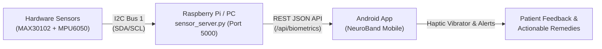
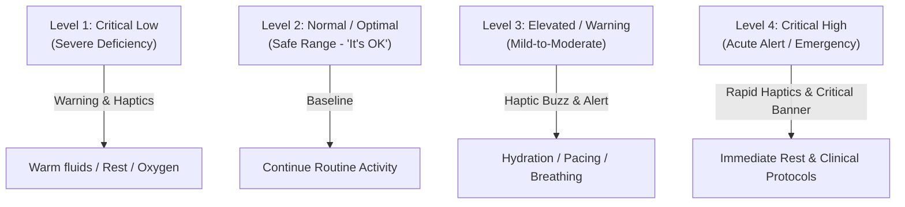

# 📘 NeuroBand AI™ - System Execution Guide & 4-Level Sensor Threshold Matrix

Comprehensive operational documentation for the **NeuroBand AI™** wearable system. This guide covers how to run the entire project (Raspberry Pi/Python server and Android app), the Light/Dark theme configuration, vibration guidance, and the complete clinical **4-level threshold matrix** (ranges, system outputs, haptic vibration patterns, warnings, and medical remedies).

---

## 🚀 1. How to Run the Project (Step-by-Step)



### A. Running the Python Sensor Bridge Server (`sensor_server.py`)

The Python server runs on the Raspberry Pi (or your PC/laptop in testing mode) and provides the REST API consumed by the Android app.

#### 1. Requirements & Dependencies
Ensure Python 3.8+ is installed. Install required packages:
```bash
pip install flask flask-cors
# If running on Raspberry Pi with hardware sensors:
pip install smbus2
```

#### 2. Starting the Server
* **On Raspberry Pi (with hardware sensors):**
  ```bash
  cd ~/Neuroband-AI/neuroband_server
  python sensor_server.py
  ```
* **On Windows / Mac / Linux (Development & Testing Mode):**
  ```powershell
  cd neuroband_server
  python sensor_server.py
  ```
  *(The server will automatically detect that I2C is not attached and switch to **Simulation Mode**, generating realistic biometric telemetry and allowing manual threshold testing).*

* The server outputs:
  ```text
  =================================================================
     NEUROBAND AI - ULTRA PRECISION SENSOR SERVER
     Listening on http://0.0.0.0:5000
     REST API Endpoint: http://<IP_ADDRESS>:5000/api/biometrics
     Simulation Test:   http://<IP_ADDRESS>:5000/api/simulate?hr=115
  =================================================================
  ```

#### 3. Verifying in Web Browser
Open your browser and navigate to:
```text
http://localhost:5000
# Or from another device on the Wi-Fi:
http://<YOUR_IP_ADDRESS>:5000
```
You will see the live status dashboard with interactive buttons to test different threshold events (Normal, High Pulse, Low Pulse, Tremor Spike, Low SpO2).

---

### B. Running the Android Application

#### 1. Open in Android Studio
1. Launch **Android Studio** (Hedgehog, Iguana, Jellyfish, Koala, Ladybug, or newer).
2. Choose **Open** and select the root directory: `c:\Users\Likhith Kumar\Downloads\Neuroband-AI`.
3. Wait for Gradle to sync.

#### 2. Run the App
1. Select your target device:
   * **Physical Android Phone:** Connect via USB or Wi-Fi debugging (ensure developer options & USB debugging are enabled).
   * **Android Emulator:** Select an emulator running Android 8.0+ (API 26+) or higher.
2. Click the green **▶ Run ('app')** button in Android Studio.

#### 3. Connect App to the Sensor Server
1. In the app, open the **Settings / Sensor Bridge** tab (the 4th icon on the floating bottom navigation bar).
2. Enter the IP address of your sensor server:
   * If using **Android Emulator** and running server on the same PC: enter `10.0.2.2`.
   * If using **Physical Phone**: enter your computer's or Raspberry Pi's local Wi-Fi IP (e.g. `192.168.1.50`).
3. Tap **SAVE HOST** and then **TEST LINK**.
4. The status pill will turn **ONLINE 🟢**, and live telemetry will stream to the home dashboard every 1.5 seconds!

---

### C. Using the Light / Dark Theme

1. In the app, navigate to the **Settings** tab.
2. Under the **APPEARANCE & THEME** card, toggle the switch:
   * ☀️ **Clean Light Theme:** High-contrast crisp dark text on clean white surfaces with soft ambient pastel gradients.
   * 🌙 **Dark Cyber Theme:** Deep navy cyber slate background with glowing neon accents.
3. The app instantly updates all screens, cards, rings, charts, and bottom navigation.

---

### D. Testing Vibration Guidance & Actionable Remedies

To verify that haptic vibrations and warning banners function on your phone:
1. Open the **Settings** tab.
2. Under **CONSOLE & ALERTS PREFERENCES**, ensure **"Tactile Vibration Guidance"** is toggled ON.
3. Tap the **"TEST VIBRATION & REMEDY WARNING"** button.
4. Your phone will immediately vibrate, navigate to the **Home** tab, and display a prominent warning banner with an actionable remedy (e.g. *"Drink a glass of cool water, sit down comfortably, and take slow 4-7-8 deep breaths"*).

---

## 📊 2. Clinical 4-Level Sensor Threshold Matrix

The system classifies biometric and kinematic measurements into **4 distinct clinical levels**:



---

### Matrix 1: Pulse Rate / Heart Rate (BPM)
*Normal Baseline: 60 – 100 BPM*

| Level | Range (BPM) | Classification | System Output | App Warning Banner | Vibration Pattern | Actionable Remedy / Suggestion |
| :--- | :--- | :--- | :--- | :--- | :--- | :--- |
| **Level 1** | **< 55 BPM** | 🔴 Critical Low (Bradycardia) | Status: Low<br/>Alert Level: Warning | ⚠️ *"Heart Rate Decreasing (e.g. 48 BPM) - Bradycardia Warning"* | Dual buzz:<br/>`200ms ON, 100ms OFF, 200ms ON` | **Sit down to avoid dizziness, stay warm, gently flex fingers/wrists, and drink a cup of warm water or tea.** |
| **Level 2** | **55 – 100 BPM** | 🟢 **Normal ("It's OK")** | Status: Normal<br/>Alert Level: None | None (Steady green pulse display: *"BPM • OPTIMAL"*) | No vibration | **Cardiovascular state is optimal. Continue normal daily activities.** |
| **Level 3** | **101 – 120 BPM** | 🟡 Elevated (Mild Tachycardia) | Status: Elevated<br/>Alert Level: Warning | ⚠️ *"Heart Rate Increasing (e.g. 112 BPM) - Elevated Pulse Warning"* | Pulsed buzz:<br/>`200ms ON, 100ms OFF, 200ms ON` | **Drink a glass of cool water, sit down in a relaxed posture, and take slow 4-7-8 deep breaths.** |
| **Level 4** | **> 120 BPM** | 🔴 Critical High (Severe Tachycardia) | Status: Critical<br/>Alert Level: Emergency | 🚨 *"Critical Pulse Alert (e.g. 135 BPM) - Severe Tachycardia"* | Rapid emergency pulse:<br/>`350ms ON, 150ms OFF, 350ms ON, 150ms OFF, 350ms ON` | **Stop all physical exertion immediately. Sit upright, sip cool water slowly, apply a cold compress to the neck/face, and practice diaphragmatic calming.** |

---

### Matrix 2: Blood Oxygen Saturation ($SpO_2$ %)
*Normal Baseline: 95 – 100%*

| Level | Range (%) | Classification | System Output | App Warning Banner | Vibration Pattern | Actionable Remedy / Suggestion |
| :--- | :--- | :--- | :--- | :--- | :--- | :--- |
| **Level 1** | **< 89%** | 🔴 Critical Low (Severe Hypoxemia) | Status: Critical<br/>Alert Level: Emergency | 🚨 *"Critical SpO2 Alert (e.g. 87%) - Severe Oxygen Desaturation"* | Triple urgent buzz:<br/>`350ms ON, 150ms OFF, 350ms ON, 150ms OFF, 350ms ON` | **Sit straight up, loosen tight clothing around neck/chest, practice pursed-lip breathing, and seek immediate medical assistance.** |
| **Level 2** | **89% – 93%** | 🟡 Moderate Low (Mild Hypoxia) | Status: Warning<br/>Alert Level: Warning | ⚠️ *"Blood Oxygen Decreasing (e.g. 91%) - Low Oxygen Alert"* | Dual buzz:<br/>`200ms ON, 100ms OFF, 200ms ON` | **Sit upright with relaxed shoulders, open a window for fresh airflow, and practice deep diaphragmatic inhalation.** |
| **Level 3** | **94% – 95%** | 🟡 Borderline Acceptable | Status: Borderline<br/>Alert Level: Observation | Subtle banner on analytics tab | No vibration | **Ensure sensor is clean and placed firmly on the fingertip. Rest quietly and breathe deeply.** |
| **Level 4** | **96% – 100%** | 🟢 **Normal ("It's OK")** | Status: Optimal<br/>Alert Level: None | None (Steady blue/cyan badge: *"SpO2 98%"*) | No vibration | **Blood oxygenation is healthy and optimal.** |

---

### Matrix 3: Tremor & Kinematics (MPU6050 Gyroscope Angular Rate & Accelerometer)
*Normal Baseline: < 40 °/s, Accel ~1.0g*

| Level | Gyro Range (°/s) | Classification | System Output | App Warning Banner | Vibration Pattern | Actionable Remedy / Suggestion |
| :--- | :--- | :--- | :--- | :--- | :--- | :--- |
| **Level 1** | **< 20 °/s** | 🟢 **Normal / Resting ("It's OK")** | Status: Stable<br/>Alert Level: None | None (*"Kinematics Stable"*) | No vibration | **No involuntary shaking. Motor stability is healthy.** |
| **Level 2** | **20 – 45 °/s** | 🟡 Mild Motion / Activity | Status: Active<br/>Alert Level: None | Voluntary movement tracked | No vibration | **Routine limb motion or voluntary motor task.** |
| **Level 3** | **46 – 80 °/s** | 🟠 Elevated Tremor (Moderate Vibration) | Status: Warning<br/>Alert Level: Warning | ⚠️ *"Tremor & Motion Increasing (e.g. 58 °/s) - Motor Instability"* | Rhythmic buzz:<br/>`200ms ON, 100ms OFF, 200ms ON` | **Rest forearm firmly on a flat table, relax shoulder muscles, perform slow finger stretching, and check medication schedule.** |
| **Level 4** | **> 80 °/s** | 🔴 Severe Tremor / Spasm | Status: Critical<br/>Alert Level: Critical | 🚨 *"Critical Tremor Alert (e.g. 92 °/s) - Severe Motor Spasm"* | Rapid emergency pulse:<br/>`350ms ON, 150ms OFF, 350ms ON, 150ms OFF, 350ms ON` | **Support limbs in a seated position, avoid holding objects to prevent dropping, rest hands on cushions, and initiate guided relaxation.** |

---

### Matrix 4: Body / Skin Temperature (°C)
*Normal Baseline: 36.1 – 37.2 °C*

| Level | Range (°C) | Classification | System Output | App Warning Banner | Vibration Pattern | Actionable Remedy / Suggestion |
| :--- | :--- | :--- | :--- | :--- | :--- | :--- |
| **Level 1** | **< 35.5 °C** | 🔴 Critical Low (Hypothermia) | Status: Low<br/>Alert Level: Warning | ⚠️ *"Temperature Decreasing (e.g. 35.1 °C) - Hypothermia Warning"* | Dual buzz:<br/>`200ms ON, 100ms OFF, 200ms ON` | **Add warm layers, cover extremities, drink warm fluids, and move to a heated room.** |
| **Level 2** | **35.5 – 37.2 °C** | 🟢 **Normal ("It's OK")** | Status: Normal<br/>Alert Level: None | None (*"Temp Normal"*) | No vibration | **Thermoregulation is balanced.** |
| **Level 3** | **37.3 – 38.3 °C** | 🟡 Low-Grade Fever | Status: Elevated<br/>Alert Level: Warning | ⚠️ *"Temperature Increasing (e.g. 37.9 °C) - Low-Grade Fever"* | Single gentle pulse:<br/>`200ms ON` | **Drink cool water or electrolytes, rest in a ventilated area, and apply a cool damp cloth to forehead.** |
| **Level 4** | **> 38.4 °C** | 🔴 High Fever (Hyperthermia) | Status: Critical<br/>Alert Level: Emergency | 🚨 *"Critical Fever Alert (e.g. 38.8 °C) - High Fever"* | Triple buzz:<br/>`350ms ON, 150ms OFF, 350ms ON` | **Hydrate frequently, wear light breathable clothing, rest in a cool space, and take antipyretic medication if prescribed.** |

---

### Matrix 5: Electrodermal Activity (GSR) & Stress Score
*Normal Baseline: 1.0 – 3.5 µS (Stress Score 10 – 50)*

| Level | GSR (µS) / Score | Classification | System Output | App Warning Banner | Vibration Pattern | Actionable Remedy / Suggestion |
| :--- | :--- | :--- | :--- | :--- | :--- | :--- |
| **Level 1** | **< 2.0 µS / 0–30** | 🟢 Relaxed ("It's OK") | Status: Calm | None (*"Optimal Autonomic Balance"*) | No vibration | **Sympathetic nervous activity is calm. High mental clarity.** |
| **Level 2** | **2.0–3.5 µS / 31–60** | 🟢 Normal Workload | Status: Baseline | None (*"Active Focus"*) | No vibration | **Standard cognitive focus during daily routines.** |
| **Level 3** | **3.6–5.0 µS / 61–80** | 🟡 Elevated Cognitive Stress | Status: Warning | ⚠️ *"Stress GSR Surge (e.g. 4.2 µS) - High Cognitive Load"* | Soft guidance pulse:<br/>`200ms ON` | **Pause what you are doing, take a 2-minute mindful pause, drink a cup of water, and un-clench jaw and shoulders.** |
| **Level 4** | **> 5.0 µS / 81–100** | 🔴 Acute Stress / Burnout Spike | Status: Critical | 🚨 *"Acute Stress Surge - High Cognitive Exhaustion Risk"* | Triple alert pulse:<br/>`350ms ON, 150ms OFF, 350ms ON` | **Stop screen work immediately, step outside for fresh air, drink cool water, and start the 3-minute Diaphragmatic Breathwork flow in the app.** |

---

## 🔬 3. How Explainable AI (SHAP / XAI) Interprets These Deviations

In NeuroBand AI, every alert is mathematically traceable using **SHAP values**:

$$f(x) = E[f(x)] + \phi_{HR} + \phi_{SpO2} + \phi_{Tremor} + \phi_{Temp} + \phi_{GSR}$$

* **Base Expected Value $E[f(x)] = 0.05$ (Safe Baseline)**: When all sensors are in Level 2, each feature's contribution $\phi_i \le 0$, pulling the patient anomaly risk down to zero.
* **Feature Deviation $\Delta = \text{Current Value} - \text{Expected Value}$**:
  * If Pulse jumps from $72 \to 118\text{ BPM}$ ($\Delta = +46$), $\phi_{HR} = +0.48$, dominating the model output and explaining: *"Pulse Rate elevation is the 84% primary contributor to this risk alert."*
  * If Tremor spikes from $1.5 \to 68\text{ }^\circ/\text{s}$, $\phi_{Tremor} = +0.52$, attributing the alert to involuntary motor symptoms.
* This ensures that the patient and clinician receive **transparent, understandable explanations** instead of opaque numbers.

